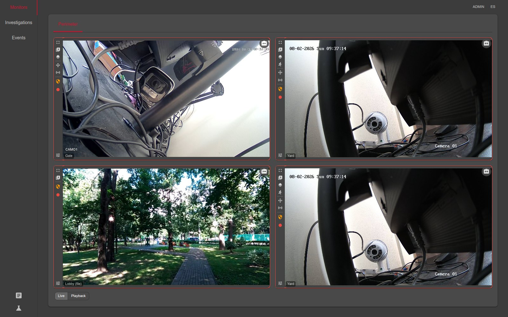
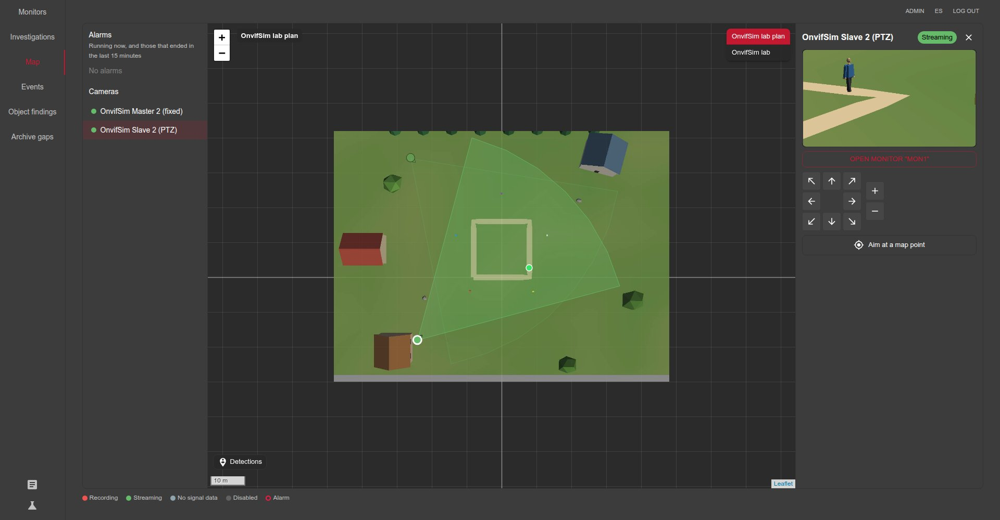
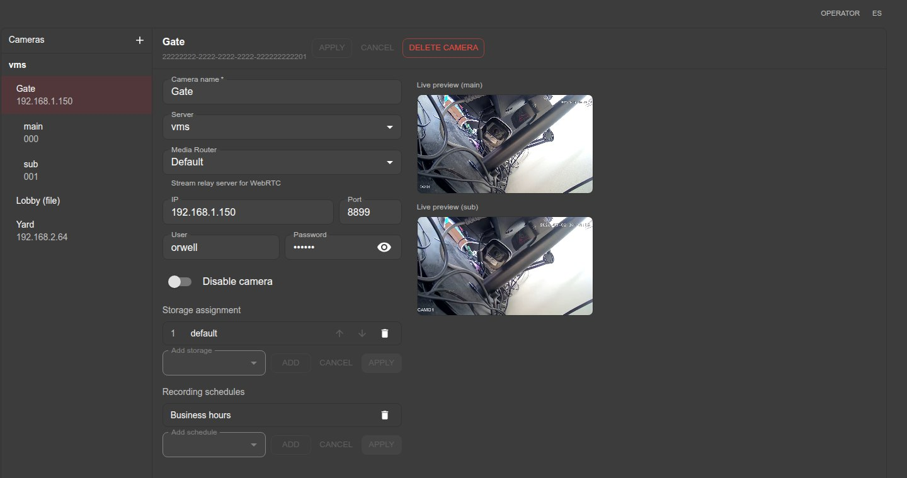
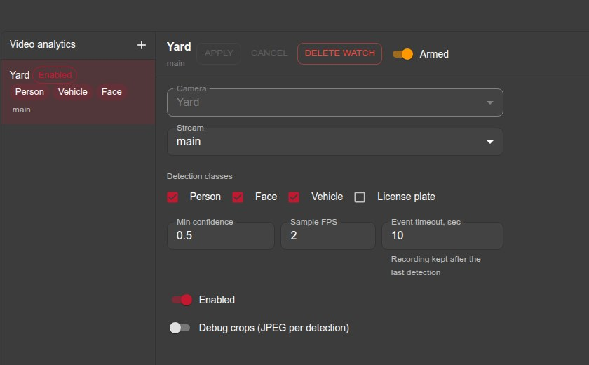

# TreeAlarm VMS

<p align="center">
  
</p>

<p align="center">
  <a href="LICENSE"></a>
  <a href="https://treealarm.dev/"></a>
  <a href="https://github.com/treealarm/ta_install"></a>
  <a href="https://github.com/sponsors/treealarm"></a>
</p>

**A video management system you can run yourself.** TreeAlarm VMS records, stores and plays back
video from IP cameras. It talks ONVIF and RTSP to the cameras, writes the archive as fragmented MP4,
streams live video to the browser over WebRTC, and runs OpenVINO detection on top. It is a set of
small services that come up together with one `docker compose up`, on your own hardware, with no
cloud account and no per-camera licence.

## What it does

- **Video walls with synchronised playback.** Several cameras on one screen and one playhead for all
  of them, over a timeline that shows exactly what was recorded. Each tile picks the stream that
  fits its size.
- **Recording on a schedule and on alarm.** Continuous or pre-alarm, with pre- and post-record
  windows, so the seconds before an event are kept too. When a camera's link drops, the gap is
  filled afterwards from the camera's own SD card.
- **Detection with a review gallery.** People, faces and vehicles, each event with crops, and boxes
  drawn over live video. Search by appearance finds the same person or vehicle across cameras.
- **Full ONVIF control.** Discovery, PTZ with presets, encoder and image settings, relays and digital
  inputs, device time and reboot.
- **PTZ auto-tracking.** Click an object and the camera keeps it in frame, or let it pick targets
  itself. A fixed camera can drive a PTZ through the map: the PTZ is aimed at where on the ground the
  fixed camera sees someone.
- **Maps and floor plans.** Cameras where they really stand, their fields of view, and live
  detections on the ground.
- **Archive re-compression.** Finished clips are re-encoded later with the detected objects kept
  sharp, so the archive takes less space while plates and faces stay readable.

The full list, with screenshots, is at [treealarm.dev](https://treealarm.dev/en/features/).

<p align="center">
  
</p>

<table>
  <tr>
    <td width="50%"></td>
    <td width="50%"></td>
  </tr>
</table>

## Install

Prebuilt images and one compose file; no source checkout is needed to run it:

```sh
git clone https://github.com/treealarm/ta_install
cd ta_install
docker compose --env-file .env up -d
```

The web interface comes up on port `5134`. [ta_install](https://github.com/treealarm/ta_install)
says which defaults to replace before a real deployment, and how to give the encoders an Intel
iGPU.

## How it is built

Each service does one job and talks to the others over [Dapr](https://dapr.io/), with PostgreSQL
for state and RabbitMQ as the message bus.

| Part | What it does |
|---|---|
| `media_server/` (C++20) | Pulls RTSP from the cameras, writes the archive, transcodes HEVC to H.264 for browsers |
| `web_vms/web_vms.Server` | The gateway the browser talks to: REST, WebRTC (WHEP) and archive HLS |
| `web_vms/web_vms.client` | The web interface (React, TypeScript, Vite) |
| `web_vms/VmsCfg` | Every piece of configuration: cameras, storages, profiles, maps |
| `web_vms/VmsFs` | The archive on disk: clips, retention, filling gaps from camera SD cards |
| `web_vms/VmsOnvif`, `VmsOnvifActors` | ONVIF: discovery, events, PTZ, device settings |
| `web_vms/VmsPtzTrackingSingleton` | PTZ tracking and aiming one camera from another through the map |
| `web_vms/VmsAnalyticsSingleton` | Hands cameras to the analytics workers and keeps their detections |
| `roitrc/` (C++) | Re-compresses finished clips, keeping detected objects sharp |
| `web_vms/VmsUtils`, `VmsLogger`, `VmsSingleton`, `VmsSquareSingleton` | MediaMTX control, logs, system-wide jobs, the TreeAlarm integration |

Live video reaches the browser through [MediaMTX](https://github.com/bluenviron/mediamtx). Detection
runs in a separate worker, [video_a](https://github.com/treealarm/video_a).

## Building from source

Development runs on Linux with Docker, the .NET 10 SDK, Node.js, and GCC 13 or newer with vcpkg
for the C++ services; [docs/windows-build.md](docs/windows-build.md) covers Windows.
[docs/docker-bringup.md](docs/docker-bringup.md) is the runbook for building the images and
bringing the stack up, and the debug configurations in `.vscode/` start every service under the
debugger at once.

The encoding library that `media_server` and `roitrc` link (the `roitrc/ta_roienc` submodule) is
not public yet, so those two build only where it can be checked out; everything else — the .NET
services and the web interface — builds from this repository alone. Use the prebuilt images from
`ta_install` for the other two.

## Testing without cameras

[OnvifSim](https://github.com/treealarm/OnvifSim) simulates ONVIF cameras, fixed and PTZ, looking at
a 3D world. `tests/onvifsim` uses it as a bench for the PTZ calibration and aiming: it hangs the
cameras every way real ones are hung (upside down, leaning, axes counted backwards) and measures
where the head really points against the simulator's ground truth.

## Related repositories

| Repository | |
|---|---|
| [ta_install](https://github.com/treealarm/ta_install) | The product: prebuilt images and the compose file |
| [video_a](https://github.com/treealarm/video_a) | The detection worker (OpenVINO) |
| [OnvifSim](https://github.com/treealarm/OnvifSim) | ONVIF camera simulator, used to test PTZ without hardware |
| [OnvifLib](https://github.com/treealarm/OnvifLib) | The ONVIF client library the services use |
| [Square](https://github.com/treealarm/Square) | TreeAlarm, the map-based monitoring system this VMS plugs into |

## Works with TreeAlarm

[TreeAlarm](https://github.com/treealarm/Square) is a map-based monitoring system. Connected to it,
the cameras become objects on its map: watch them live, scrub the archive, drive PTZ and receive
alarms in its event stream, behind one sign-in. The integration is off by default and turned on in
`ta_install`'s `.env` (`KEYCLOAK_URL` and the `SQUARE_*` settings).

## Support the project

TreeAlarm VMS is free. If it is useful to you, [sponsoring it on GitHub](https://github.com/sponsors/treealarm)
helps keep it going. Bug reports and feature requests are welcome in
[Issues](https://github.com/treealarm/ta_vms/issues).

## License

[MIT](LICENSE). The images bundle third-party software under its own licences, among them FFmpeg,
which in these builds includes GPL-licensed encoders.
